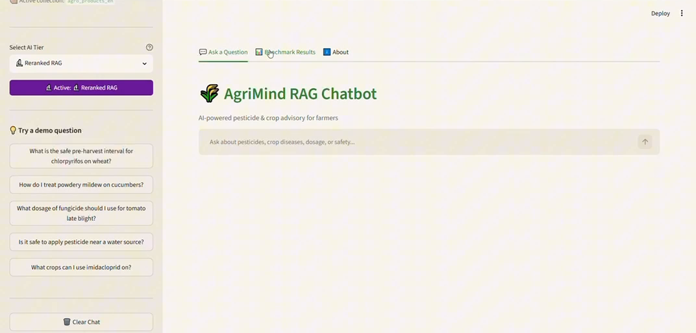
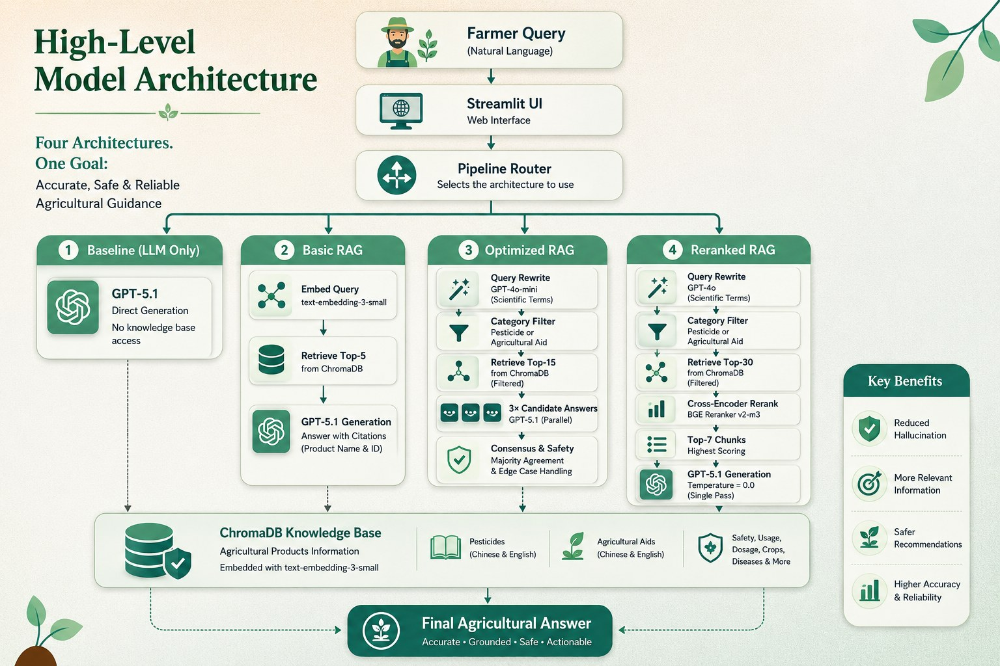
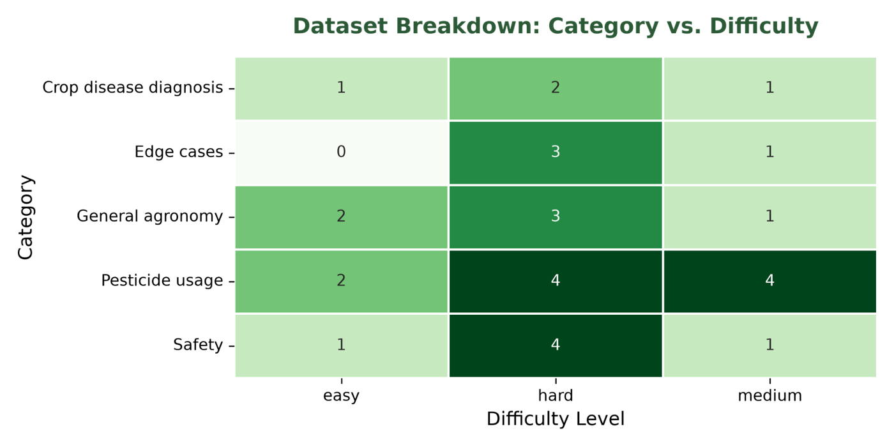
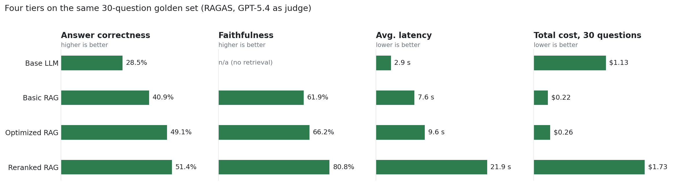

# AgriMind: Multilingual RAG for Agricultural Advisory

> **Case study.** AgriMind was built for an agritech client, so the source code and product
> catalog are confidential. This repository documents the problem, the architecture, the
> design decisions and the evaluation results, with a [demo video](https://www.youtube.com/watch?v=s7wyjOYOYDc).
> I'm happy to walk through the implementation in an interview.

AgriMind answers farmers' questions about pesticides, dosages, crop diseases and chemical
safety in **English, Chinese and Arabic**. It is grounded in a verified product catalog and
cites the source of every answer. Four system designs, from a plain LLM to a reranked RAG
pipeline, were benchmarked on a 30-question golden set with **RAGAS**. The choice between
them is framed as a trade-off between accuracy, latency and cost.

**▶ [Watch the 3-minute demo](https://www.youtube.com/watch?v=s7wyjOYOYDc)**: all four tiers answer the same questions in English, Chinese and Arabic, followed by the benchmark and architecture tabs.

## The problem

General-purpose LLMs answer from memory. When a product is not in their training data,
they still produce a confident-sounding answer. In agriculture that is a physical risk: a
wrong dilution ratio or a missed pre-harvest interval can damage crops, break regulations
or harm consumers. Farmers need answers that are **grounded in a verified source,
traceable, and able to say "I don't know"**.

## Data

| | |
|---|---|
| Source | One proprietary, client-verified product catalog (no public or scraped data) |
| Products | 114 (50 pesticides, 64 auxiliary growth products) |
| Fields per product | Name, type, instructions, crops, ingredients, dilution, dosage, package size, safety precautions |
| Chunks | 570 per language, in 5 types per product: identity, usage, crops, ingredients, safety |
| Collections | Two ChromaDB collections, English and Chinese (570 × 2) |

**Preprocessing pipeline:** translate (CN → EN with GPT-4o-mini), then clean (fix units, fill
missing values, standardise whitespace), then chunk by type, then embed
(`text-embedding-3-small`, 1,536 dimensions), then store (ChromaDB, cosine similarity, with
metadata for citations).

**Numerical integrity:** every translated number (doses, dilution ratios, intervals) was
automatically checked against the Chinese original, and any mismatch was flagged before
ingestion. A translation error in a dosage is exactly the kind of bug this system exists to
prevent.

## Architecture

| Tier | Pipeline | Why it exists |
|---|---|---|
| **Base LLM** | GPT-5.1, no retrieval | Control group: shows what an ungrounded model does |
| **Basic RAG** | Embed query → top-5 chunks → GPT-5.1 answers with citations | The simplest grounded system |
| **Optimized RAG** | Query rewrite into scientific terms (GPT-4o-mini) → category filter (pesticide / auxiliary) → top-15 → **3 candidate answers in parallel** → majority agreement and edge-case handling | Tackles vague farmer wording and one-off generation errors |
| **Reranked RAG** | Query rewrite → category filter → top-30 → **cross-encoder rerank (BAAI/bge-reranker-v2-m3)** → top-7 → GPT-5.1 at temperature 0 | Recall-oriented first stage with a precise second stage |

**Multilingual design.** Users pick the English or Chinese collection. Because the
embedding model is multilingual, a query in any language (including Arabic, which has no
collection of its own) retrieves from either one. The LLM always answers in the language
the farmer wrote in and cites the source products.

**Serving.** A FastAPI REST backend exposes all four tiers. A bilingual Streamlit front end
lets you switch tiers, languages and collections, see the retrieved sources, and browse the
benchmark.

## Evaluation

**Golden dataset.** 30 questions in English, Chinese and Arabic. Each has a reference answer
and its source context. The set is weighted toward hard, high-stakes categories: pesticide
usage (10), safety and pre-harvest intervals (6), general agronomy (6), crop disease
diagnosis (4), and edge cases where the right answer is a refusal (4). By difficulty: 6
easy, 8 medium, 16 hard.

**Metrics.** RAGAS faithfulness, answer relevance, context precision, context recall and
answer correctness, plus a **safe refusal rate** on the edge cases, which asks whether the
system declines instead of making something up. The judge is **GPT-5.4**, a different model
from the generator (GPT-5.1), to avoid self-preference bias. Every score and the judge's
explanation are logged per query to Weights & Biases, and low-scoring traces were used to
refine prompts and guardrails.

### Results

| Metric | Base LLM | Basic RAG | Optimized RAG | Reranked RAG |
|---|---|---|---|---|
| Answer correctness | 28.52% | 40.87% | 49.12% | **51.42%** |
| Context recall | — | 68.86% | 80.22% | **82.72%** |
| Context precision | — | 79.71% | 72.28% | **81.52%** |
| Answer relevance | — | 53.41% | 67.92% | **79.23%** |
| Faithfulness | — | 61.91% | 66.19% | **80.77%** |
| Hallucination rate (1 − faithfulness) | — | 38.09% | 33.81% | **19.23%** |
| Safe refusal rate | 0% | 75% | 75% | 75% |
| Avg. latency | **2.93 s** | 7.58 s | 9.62 s | 21.89 s |
| Total cost (30 questions) | $1.126 | **$0.224** | $0.259 | $1.731 |

### What the numbers say

- **Grounding works.** Every RAG tier beat the base LLM on answer correctness (+12 to +23
  points). The base model never refused, while every RAG tier refused 3 of the 4 unsafe or
  out-of-scope questions.
- **Reranking buys trust, not just accuracy.** The cross-encoder gave the biggest jump in
  faithfulness (66% → 81%), cutting unsupported claims almost in half compared with Basic RAG.
- **But it costs a lot.** Reranked RAG took 2.3× as long and cost 6.7× as much as Optimized
  RAG, for about 2 more points of correctness.
- **No single winner.** Basic RAG is the cheapest grounded option. Optimized RAG gives the
  best accuracy per dollar. Reranked RAG is the choice when faithfulness matters more than
  latency. The right tier depends on the deployment.
- **Retrieval is not the bottleneck.** Context recall reaches 80% and above, yet answer
  correctness stays around 50%. This suggests that most remaining errors come from
  generation or from imperfect reference answers, rather than from missed retrieval.

## Limitations

- **Small, model-generated golden set.** 30 questions is too few for statistically robust
  conclusions, and the reference answers were generated by the same model family used as the
  judge. Agronomist-verified references are the top priority.
- **Safe refusal is 75%, not 100%.** One edge case still gets an answer in every tier.
- **Approximate retrieval metrics.** Context precision and recall were computed against
  product-level references rather than exact chunk IDs, so they are estimates.

## Next steps

1. Replace LLM-generated references with answers verified by agronomists.
2. Scale the golden set from 30 to 150+ questions.
3. Push the safe refusal rate towards 100%, for example with a dedicated scope classifier before generation.
4. Add in-field feedback from farmers alongside the RAGAS scores.

## Tech stack

**LLMs:** GPT-5.1 (generation), GPT-4o-mini (query rewriting, translation), GPT-5.4 (judge) ·
**Retrieval:** OpenAI `text-embedding-3-small`, ChromaDB, BAAI `bge-reranker-v2-m3` ·
**Serving:** FastAPI, Streamlit · **Evaluation:** RAGAS, Weights & Biases

## Team

Capstone project by **Abeer Alsaeed, Maan Adam and Ghufran Alsiyami**, delivered for an
agritech client.

**Maan Adam** · [LinkedIn](https://www.linkedin.com/in/maan-adam-b57320245)
